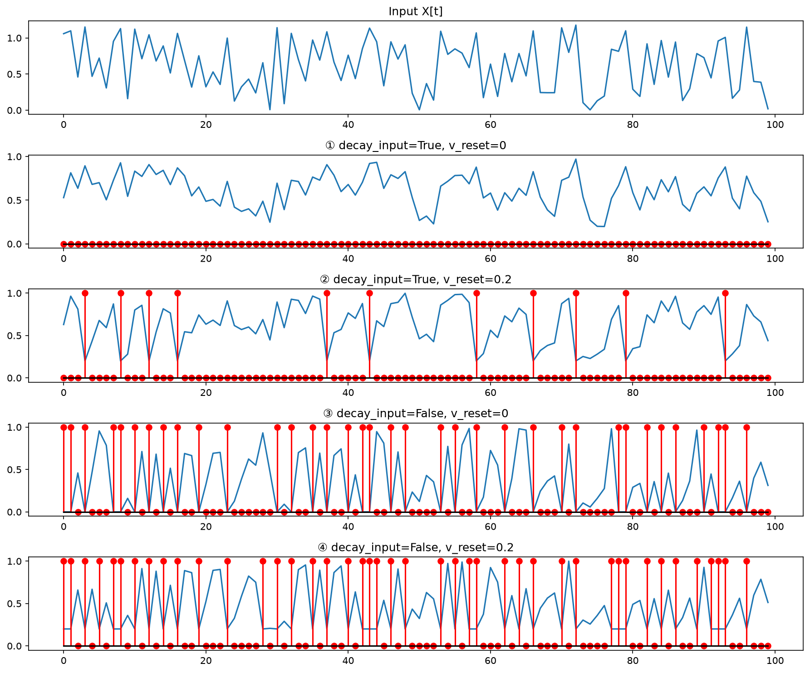

# snn-learning

我是山东大学（威海）大一学生，方向：物理 → 类脑计算 / 脉冲神经网络（SNN）。

这个仓库记录我从零学 SNN 的过程：代码、图、以及每步的结论。不是教程，是我的实验笔记。

## 已完成

| # | 内容 | 文件 |
|---|---|---|
| 1 | LIF 脉冲神经元：四种参数组合（decay_input × v_reset）的膜电位与放电对比 | [`lif/`](lif/) |



**这张图怎么看**：第 1 行是输入电流，下面 4 行是同一个 LIF 神经元在四种参数下的表现；蓝线是膜电位，竖线是放电脉冲。

- `v_reset=0`：膜电位只能涨到接近输入值，几乎不放电
- `v_reset=0.2`：复位点抬高后稳定放电
- `decay_input=False`：输入不被衰减，放电明显更密

## 环境

- Python 3.12 + PyTorch（CPU）+ matplotlib
- 跑法：

```bash
cd lif
pip install torch matplotlib
python lif.py
```

## 下一步

- [ ] 03：把 LIF 堆成两层，做 MNIST 分类
- [ ] 04：搞清前向传播里时间步 T 怎么展开
- [ ] 05：理解梯度替代（surrogate gradient）

## 联系

Einsry — 1227094192@qq.com
